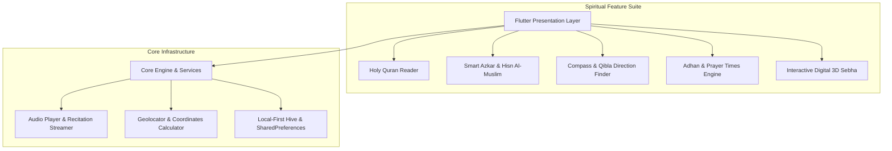

# 🕋 سكن الروح / نور الهدى (Sakan Al-Rooh — Islamic Spiritual Companion)

[](https://flutter.dev)
[](https://dart.dev)
[](#)
[](#)

> **تطبيق إسلامي شامل وفاخر**: تلاوة المصحف الشريف بالرسم العثماني، حصن المسلم والأذكار الذكية، محدد القبلة البصري، مواقيت الصلاة والأذان، والسبحة الرقمية ثلاثية الأبعاد.

---

## 🏛️ System Architecture



---

## 🌟 أبرز مميزات التطبيق (Key Features)

1. **📖 المصحف الشريف والتلاوات الصوتية**:
   - عرض سور القرآن الكريم كاملة (114 سورة) بالخط العثماني الواضح.
   - استماع لتلاوات أشهر القراء مع حفظ العلامات المرجعية والصفحات الأخيرة.

2. **🧭 بوصلة القبلة الذكية ومواقيت الصلاة**:
   - حساب دقيق لمواقيت الصلاة الخمس مع إشعارات الأذان التلقائية.
   - بوصلة جغرافية حية موجهة بدقة نحو الكعبة المشرفة وفق إحداثيات GPS.

3. **📿 السبحة الإلكترونية التفاعلية**:
   - محاكاة عداد التسبيح مع استجابة اهتزازية (Haptic Feedback) وعدادات يومية وإحصائيات تسبيح تراكمية.

4. **🛡️ حصن المسلم والأذكار اليومية**:
   - أذكار الصباح والمساء، أذكار النوم والاستيقاظ، وأدعية مختارة من الكتاب والسنة مع مؤقتات القراءة.

---

## 🛠️ Setup & Installation

### 1. Prerequisites
- Flutter SDK 3.16+
- Android Studio / VS Code

### 2. Configure Credentials
Copy the example configuration files:
```bash
cp android/key.properties.example android/key.properties
cp android/app/google-services.json.example android/app/google-services.json
```
*Fill in your own release signing keys and Firebase configurations.*

### 3. Run the App
```bash
flutter pub get
flutter run
```
