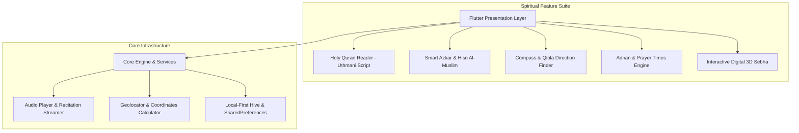

# 🕋 سكن الروح / نور الهدى (Sakan Al-Rooh — Islamic Spiritual Companion)

<p align="center">
  
</p>

<p align="center">
  <br/>
  <b>رفيقك الإيماني اليومي — تطبيق إسلامي متكامل فائق الدقة والأناقة</b>
</p>

<p align="center">
  <a href="https://flutter.dev"></a>
  <a href="https://dart.dev"></a>
  
  
  
</p>

---

## 🏛️ System Architecture



---

## 🌟 أبرز مميزات التطبيق (Key Features)

1. **📖 المصحف الشريف والتلاوات الصوتية**:
   - عرض سور القرآن الكريم كاملة (114 سورة) بالخط العثماني الواضح.
   - استماع لتلاوات كبار القراء مع حفظ العلامات المرجعية والصفحات الأخيرة.

2. **🧭 بوصلة القبلة ومواقيت الصلاة الدقيقة**:
   - حساب فلكي دقيق لمواقيت الصلاة الخمس مع تنبيهات الأذان التلقائية.
   - بوصلة جغرافية تفاعلية موجهة بدقة نحو الكعبة المشرفة وفق إحداثيات GPS الحية.

3. **📿 السبحة الإلكترونية التفاعلية**:
   - محاكاة عداد التسبيح مع استجابة اهتزازية (Haptic Feedback) وعدادات يومية وإحصائيات تسبيح تراكمية.

4. **🛡️ حصن المسلم والأذكار اليومية الذكية**:
   - أذكار الصباح والمساء، أذكار النوم والاستيقاظ، وأدعية مختارة من الكتاب والسنة مع مؤقتات القراءة.

---

## 🛠️ Setup & Local Build

### 1. Prerequisites
- Flutter SDK 3.16+
- Android Studio / VS Code

### 2. Configure Credentials
Copy the safe template files:
```bash
cp android/key.properties.example android/key.properties
cp android/app/google-services.json.example android/app/google-services.json
```

### 3. Run the App
```bash
flutter pub get
flutter run
```
